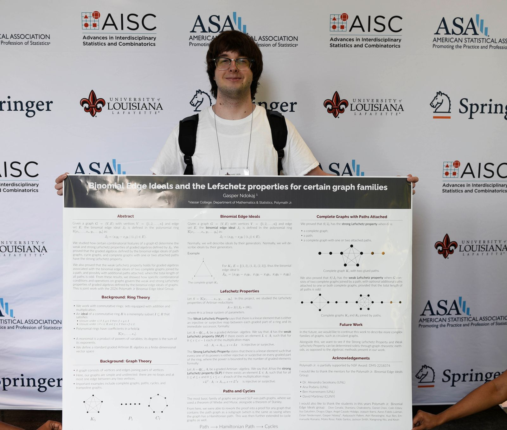

## About

Hi! I am an 3rd year undergraduate mathematics student at Vassar College. Broadly, I am interested in algebra, specifically commutative algebra, algebraic geometry, and algebraic combinatorics. I am also a fan of dynamical systems, specifically ergodic theory and dynamical billiards (with a focus in Teichmüller theory)

You can find my CV [here](CV_2026-4.pdf), and my LinkedIn [here.](https://www.linkedin.com/in/gasperndokaj)

For any questions, my email is [gndokaj@vassar.edu](mailto:gndokaj@vassar.edu)

## Presentations/Posters

- **Binomial edge ideals and the Lefschetz properties for certain graph families**

  Advances in Interdisciplinary Statistics and Combinatorics (AISC), University of Louisiana-Lafayette, October 2026
  
  Oral presentation and poster presentation given, granted 3rd place in the undergraduate poster session competition
  

- **Binomial edge ideals and the Lefschetz properties for certain graph families**

  Undergraduate Mathematics Symposium, University of Illinois-Chicago, November 2026
  
  Joint poster presentation with Ilya Galushkin (who sadly was not able to make it, but we applied together so I'm including him!)

- **Binomial Edge Ideals**

  Polymath Jr. Conference, August 2026
  
  Joint presentation with Shantanu Chakraborty, Ilya Galushkin, and Dragos Gligor.

- **Hutchinson's theorem for existence and uniqueness of fractals**

  Hudson River Undergraduate Mathematics Conference, Vassar College, April 2026
  
  Joint presentation with Henry Bonney and Jay Chen.  
  

## Research Interests

- Commutative algebra, algebraic combinatorics, dynamical systems

## Projects/Research

- Working jointly with Prof A. Seceleanu from University of Nebraska-Lincoln on Binomial Edge Ideals alongside other members of my Polymath Jr. cohort.
- Working with Manohar Kumar, PhD in a directed reading program on Lovász-Saks-Schijver ideals and parity binomial edge ideals, under the Twoples DRP. 

## Misc.

- I listen to a lot of emo and hardcore music, in fact, I run a radio show at Vassar College with WVKR where I (mostly) play emo called [Emo Over The Years](https://spinitron.com/WVKR/show/291477/Emo-Over-the-Years?layout=1). Check it out!
- I also read a lot of manga and tend to watch quite a bit of anime. My favorite piece of animanga ever is [Land of the Lustrous!](https://myanimelist.net/manga/44489/Houseki_no_Kuni) I'd recommend it to anyone, though it does get pretty dark!

